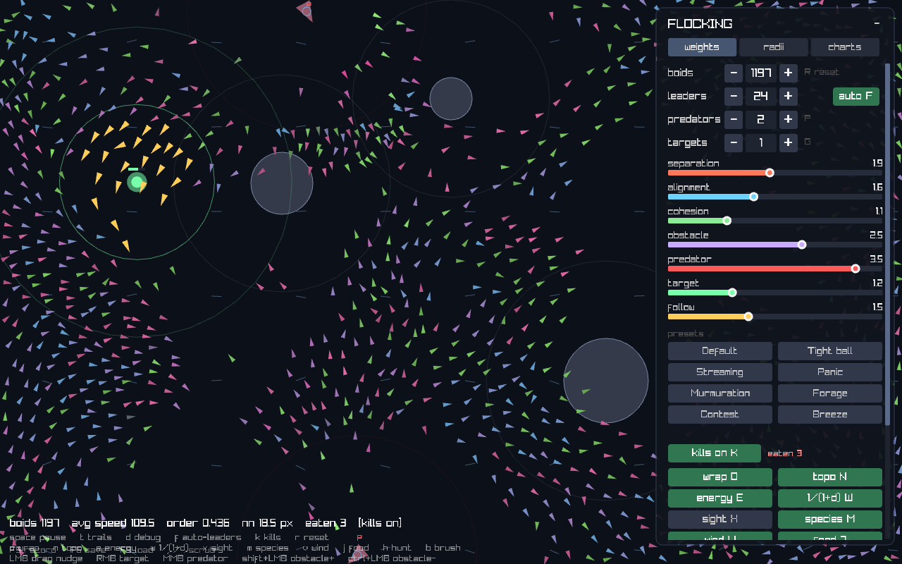

# Boids — Advanced Flocking Simulation

A C++17 / raylib implementation of Craig Reynolds' **boids** flocking model that grew
into a small ecology sandbox: predators that hunt and digest, food that depletes,
competing species, stamina, wind, a toroidal world, live charts, parameter evolution
and record/replay — all with a live, scrollable control panel.

Everything is driven by one **prioritised force budget**, so behaviour degrades
gracefully instead of exploding when the flock is under pressure.



---

## Table of contents

- [Quick start](#quick-start)
- [Build](#build)
- [Features](#features)
- [Steering model](#steering-model)
- [Parameter reference](#parameter-reference)
- [Presets](#presets)
- [Controls](#controls)
- [Control panel](#control-panel)
- [HUD and charts](#hud-and-charts)
- [Command line](#command-line)
- [Parameter evolution](#parameter-evolution)
- [Self-test](#self-test)
- [Persistence](#persistence)
- [Recording and replay](#recording-and-replay)
- [Performance](#performance)
- [Project layout](#project-layout)
- [Known limitations](#known-limitations)
- [Licences](#licences)

---

## Quick start

```sh
./run.sh          # builds if needed, sets LD_LIBRARY_PATH, runs
```

Or manually, once raylib is built (see [Build](#build)):

```sh
cmake -S . -B build -DCMAKE_BUILD_TYPE=Release
cmake --build build -j$(nproc)
LD_LIBRARY_PATH="$PWD/third_party/raylib/lib" ./build/boids
```

---

## Build

### Requirements

| | |
|---|---|
| Compiler | any C++17 compiler (GCC 9+, Clang 10+, MSVC 2019+) |
| CMake | 3.16 or newer |
| raylib | **5.5**, vendored / built locally (see below) |
| Platform | Linux is the tested target; Windows/macOS should work but are untested |
| Optional | `libtbb` — only if you enable `-DBOIDS_PARALLEL=ON` |

### 1. Build raylib 5.5

raylib is not committed as a binary. Build it once into `third_party/raylib`:

```sh
git clone --depth 1 --branch 5.5 https://github.com/raysan5/raylib.git third_party/raylib-src
cmake -S third_party/raylib-src -B third_party/raylib-build \
      -DCMAKE_BUILD_TYPE=Release \
      -DCMAKE_INSTALL_PREFIX="$PWD/third_party/raylib" \
      -DBUILD_EXAMPLES=OFF -DBUILD_SHARED_LIBS=ON
cmake --build third_party/raylib-build -j$(nproc)
cmake --install third_party/raylib-build
```

`CMakeLists.txt` expects `${PROJECT}/third_party/raylib/include/raylib.h` and
`lib/libraylib.so` to exist and fails with a clear message otherwise.

### 2. Build the simulation

```sh
cmake -S . -B build -DCMAKE_BUILD_TYPE=Release
cmake --build build -j$(nproc)
```

### Build options

| Option | Default | Effect |
|---|---|---|
| `BOIDS_PARALLEL` | `OFF` | Parallelise the per-boid force loop with `std::execution::par_unseq`. Needs a stdlib backend (libstdc++ uses TBB). Verified bit-identical to the serial path; see [Performance](#performance). |
| `CMAKE_BUILD_TYPE` | `Release` | Defaults to Release if unset. |

The build is warning-clean under `-Wall -Wextra -Wformat=2`. `-Wformat=2` is load-bearing:
it is what catches a `snprintf` whose argument list does not match its format string, a
bug class that has silently corrupted saved state in this project before.

---

## Features

**Flocking**
- Separation / alignment / cohesion with a forward field-of-view cone
- Metric (fixed radius) **or** topological (K nearest neighbours) interaction
- Optional `1/(1+d)` distance weighting
- Per-boid preferred cruise speed
- Obstacle avoidance with real tangent geometry (clean passes, no grazing)
- Boundary avoidance, hard walls, or a fully **toroidal** wrapped world

**Predation**
- Multiple predators with hunt / rest stamina cycles
- Optional **lethal** mode: a catch removes a boid and the predator digests
- One derived **hunt pressure** dial that scales predator speed, catch radius and count

**Ecology**
- **Foraging**: targets carry food that depletes and disappears, then respawns
- Per-boid **stamina** that drains with speed and panic, and caps top speed when spent
- **2–6 species** with distinct hues, optional segregation and a cross-species blend

**Environment**
- Global **wind / flow field**: sine-sum, seamless under wrap, with turbulence and gusts
- **Occlusion**: obstacles block line of sight, so boids can genuinely hide

**Tooling**
- Live **charts** tab with a shared time cursor and per-window mean / peak
- Scrollable, collapsible panel with ~27 live sliders
- Mouse tools: nudge, paint boids, erase boids, place targets / predators / obstacles
- Camera with cursor-anchored zoom, drag pan and off-screen indicator arrows
- Record / replay with a versioned binary format
- Headless runs, benchmarking, a state round-trip self-test and parameter evolution

---

## Steering model

Each behaviour produces a Reynolds steering force (`normalize(desired) * maxSpeed -
velocity`, truncated to `maxForce`). Rather than summing everything and truncating the
total, forces are applied in **priority order** against a **shared acceleration budget**
(`forceBudget × maxForce` per step):

```
predator → obstacle → separation → alignment → cohesion → target → follow → bounds → mouse → wind
```

Low-priority rules degrade gracefully when survival rules are consuming the budget, so a
flock in danger stops caring about aesthetics and a calm flock still keeps formation.

| Behaviour | Default radius | What it does |
|---|---|---|
| Predator avoidance | 170 px | Radial escape + tangential slide + panic speed-up; weight scales with closeness |
| Obstacle avoidance | rim + 110 px look-ahead | Radial push blended with a tangential slide of the real tangent length |
| Separation | 30 px | Steer away from close neighbours, weighted by `1/d²` |
| Alignment | 60 px | Match the average neighbour heading (FOV filtered) |
| Cohesion | 60 px | Steer toward the neighbour centroid (FOV filtered) |
| Target seeking | 220 px | Leaders home on the nearest active target; followers at `foodPull ×` strength |
| Leadership / following | 260 px | Followers chase nearby leaders; leaders cohere and share a heading |
| Boundary avoidance | 90 px margin | Turn-back force that grows near a wall (skipped in wrapped mode) |
| Mouse nudge | 130 px | Push / stir the flock with the cursor |
| Wind | global | The flow field, deliberately last |

**Field of view.** Alignment, cohesion and follow only see neighbours inside a forward
cone (`fovCos = -0.3`, roughly a 105° half-angle), so flocks stream instead of clumping
into blobs. Set `fovCos ≥ 1` to disable the cone.

**Leadership.** With `auto` on, leaders are re-scored once a second and are the boids
closest to the nearest target — leadership rotates and tracks the flock's purpose. With
auto off, leaders are simply the first N boids. Eating a target forces an immediate
re-score.

**Speed regulation.** Velocity is clamped to `[minSpeed, maxSpeed × cruise × fatigue]`,
where `cruise` is a per-boid multiplier and `fatigue` only applies when energy is on.

**Neighbour interaction modes.**

| Mode | Alignment / cohesion see |
|---|---|
| Metric (default) | every neighbour within the radius |
| `topo N` | the **K nearest** neighbours (`topo k`, 1-32, default 7) regardless of distance |
| `1/(1+d) W` | the same set, but each contribution is weighted by `1/(1+d)` so near neighbours dominate |

Topological interaction follows Ballerini et al. (2008): real starlings track a roughly
constant *number* of neighbours, not everything within a fixed distance. Separation is
always local and always applies, in every mode.

---

## Parameter reference

All of these live in `Params` (`src/sim.hpp`) and persist in `boids_state.json`. Values
shown are the shipped defaults.

### Steering weights (0-4)

| Parameter | Default | Meaning |
|---|---|---|
| `separation` | 1.8 | How hard to avoid crowding |
| `alignment` | 1.0 | How hard to match neighbour headings |
| `cohesion` | 0.9 | How hard to move toward the flock centre |
| `obstacle` | 2.5 | Obstacle avoidance strength |
| `predator` | 3.5 | Predator escape strength |
| `target` | 1.2 | Objective seeking strength (leaders) |
| `follow` | 1.5 | Follower to leader attraction |

### Interaction radii (px)

| Parameter | Default | Meaning |
|---|---|---|
| `separationRadius` | 30 | Personal space |
| `alignmentRadius` | 60 | Heading-matching range (metric mode) |
| `cohesionRadius` | 60 | Centroid range (metric mode) |
| `followRadius` | 260 | Follower to leader range |
| `obstacleLook` | 110 | Obstacle look-ahead, added to the obstacle radius |
| `predatorRadius` | 170 | Range at which a predator causes panic |
| `targetRadius` | 220 | Objective search radius |
| `boundsMargin` | 90 | Wall proximity at which turn-back starts |
| `boundsWeight` | 3.0 | Turn-back strength |

### Motion

| Parameter | Default | Meaning |
|---|---|---|
| `maxSpeed` | 220 | Speed cap in px/s |
| `minSpeed` | 70 | Speed floor in px/s |
| `maxForce` | 420 | Per-behaviour steering force cap |
| `forceBudget` | 2.0 | Shared acceleration budget, as a multiple of `maxForce` |

### Predation

| Parameter | Default | Meaning |
|---|---|---|
| `predatorSpeed` | 150 | Chase speed in px/s (overridden while hunt pressure is on) |
| `predatorForce` | 260 | Predator acceleration |
| `predatorHunt` | 6.0 s | Length of a hunt phase |
| `predatorRest` | 4.0 s | Length of the digest / rest phase |
| `catchRadius` | 14 | Kill radius in lethal mode (overridden by hunt pressure) |
| `huntPressure` | -1 (off) | 0-1 derived dial: sets speed 120 to 320, catch radius 10 to 40 and 1 to 4 predators. Disabled below 0, at which point the individual sliders take over again. |

`huntPressure` **overrides** `predatorSpeed` and `catchRadius` while active; those two
sliders are drawn inert and tagged `(auto)` so they do not lie about having an effect.
Turning pressure off restores the values they held before it was enabled.

### Neighbour mode

| Parameter | Default | Meaning |
|---|---|---|
| `topological` | off | Use the K nearest neighbours instead of a radius |
| `topoK` | 7 | K, 1-32 |
| `distanceWeighted` | off | Weight contributions by `1/(1+d)` |
| `occlusion` | off | Obstacles block line of sight |
| `fovCos` | -0.3 | Cosine of the half field-of-view; >=1 disables the cone |

### World shape

| Parameter | Default | Meaning |
|---|---|---|
| `periodicBounds` | off | Wrap positions; distances become toroidal; no wall force |
| `hardWalls` | on | Clamp and reflect at the screen edge when not wrapping |

### Stamina

| Parameter | Default | Meaning |
|---|---|---|
| `energyEnabled` | off | Enable per-boid stamina |
| `energyDrain` | 0.07 /s | Drain while at 75 % or more of top speed |
| `energyRecover` | 0.18 /s | Recovery while coasting |
| `energyPanicDrain` | 0.25 /s | Extra drain while a predator is within `predatorRadius` |

A spent boid's top speed falls to 45 % of normal, and it is tinted toward cold grey.

### Wind / flow field

| Parameter | Default | Meaning |
|---|---|---|
| `windStrength` | 60 | Peak force in px/s^2 |
| `windAngleDeg` | 0 | Base direction in degrees (0 = +x) |
| `windTurbulence` | 0 | 0-1 spatial variation |
| `windGust` | 0 | 0-2 temporal variation rate |

The field is a sine sum sampled per boid position, with wavenumbers quantised to the
screen size so it stays seamless across the wrap seam. Wind is the lowest-priority
force in the budget, so it never overrides survival or flocking. A sparse grid of faint
arrows shows the local field.

### Foraging

| Parameter | Default | Meaning |
|---|---|---|
| `foodDrain` | 0.05 /s | Food consumed per eating boid per second |
| `foodRadius` | 60 | How close a boid must be to eat |
| `foodPull` | 0.25 | Target-seeking strength for **followers**, as a fraction of a leader's pull (0 = leaders only) |

A target's remaining food is drawn as a shrinking ring and a bar; at zero it deactivates
and (by default) respawns at least 200 px away from the flock.

### Species

| Parameter | Default | Meaning |
|---|---|---|
| `multiSpecies` | off | Split the flock into competing species |
| `speciesCount` | 2 | 2-6 species |
| `crossSpecies` | 0.0 | 0 = fully segregated, 1 = the species split has no dynamical effect |

Alignment and cohesion only see same-species neighbours (blended by `crossSpecies`);
separation always applies across species, so flocks repel but can still overlap at the
edges. Six distinct hues are available.

### Mouse

| Parameter | Default | Meaning |
|---|---|---|
| `mouseRadius` | 130 | Nudge influence radius |
| `mousePush` | 9.0 | Nudge strength |

---

## Presets

Presets set **params and runtime toggles**, so each one is a scenario you can just watch:

| Preset | What happens |
|---|---|
| **Default** | Classic metric boids, no extras |
| **Tight ball** | Strong cohesion, short radii, slower - a dense knot |
| **Streaming** | Strong alignment, weak cohesion, narrow FOV - a long ribbon |
| **Panic** | Lethal predation on, hunt pressure 0.5, stamina on |
| **Murmuration** | Topological neighbours, wrapped world, distance weighting |
| **Forage** | Depleting food, followers pull toward objectives, no predators |
| **Contest** | Two species, fully segregated, competing for the same space |
| **Breeze** | Turbulent gusting wind with strong flocking to hold formation |

---

## Controls

### Keyboard

| Key | Action |
|---|---|
| `Space` | Pause / resume (fires on **release**, so a space-drag pan does not toggle it) |
| `R` | Reseed flock and obstacles |
| `T` | Motion trails |
| `D` | Per-boid debug overlay |
| `F` | Auto (fitness) leadership |
| `K` | Lethal predation |
| `O` | Toroidal wrap |
| `N` | Topological neighbours |
| `E` | Stamina |
| `W` | `1/(1+d)` neighbour weighting |
| `X` | Occlusion (sight blocked by obstacles) |
| `M` | Multi-species mode |
| `V` | Wind / flow field |
| `J` | Foraging (depleting food) |
| `H` | Hunt pressure (derived predator difficulty) |
| `B` | Cycle the canvas brush tool (nudge, paint, erase) |
| `P` | Toggle the first predator |
| `G` | Toggle the first target |
| `0` | Reset camera zoom and pan |
| `F11` | Toggle borderless fullscreen (Esc leaves fullscreen, it does not quit) |
| `F5` | Toggle recording |
| `F6` | Save the recording |
| `F9` | Load a recording and enter replay mode |
| `,` / `.` or `Left` / `Right` | Scrub one frame in replay (`Home` / `End` jump) |
| `Esc` | Exit replay mode / quit |

### Mouse

| Input | Action |
|---|---|
| Left-drag (canvas) | Nudge / stir the flock (in *nudge* tool) |
| Left-drag (canvas) | Paint new boids / erase boids (in *paint* / *erase* tool) |
| Left-drag on a target or obstacle | Move that handle |
| **Space + left-drag** | Pan the camera |
| Mouse wheel (canvas) | Zoom toward the cursor (0.15x to 8x) |
| Mouse wheel (panel) | Scroll the control panel - independent of the camera |
| Right-click (canvas) | Place the next target |
| Middle-click (canvas) | Place the next predator |
| **Shift + left-click** | Add an obstacle at the cursor |
| **Ctrl + left-click** on an obstacle | Remove that obstacle |
| Click a slider knob | Focus it for arrow-key fine control |

### Arrow-key fine control

With a slider focused, `Left` / `Right` nudge by 1 % of its range; hold `Shift` for 0.1 %.

---

## Control panel

The panel (top-right) is collapsible via the `-` / `+` button and **scrolls** when its
contents exceed the screen - with a mouse wheel or by dragging the scrollbar on the
right edge. Each tab starts at the top.

**Counters** (click the number to type an exact value):

- **boids** 1-1200, **leaders** 0-60 (with an `auto` pill for fitness-based selection)
- **predators** 0-8, **targets** 0-8

**Three tabs:**

1. **weights** - the seven steering weights, the eight scenario presets, the mode
   toggles (kills, wrap, topo, energy, `1/(1+d)`, sight, species, wind, food, hunt),
   the flock-count stepper with colour swatches, cross-species mix, and the canvas
   tool picker with brush radius.
2. **radii** - every remaining tuning knob: rule radii, bounds, speeds, force budget,
   predator timings and catch radius, topological K, stamina rates, wind controls,
   foraging controls, hunt pressure.
3. **charts** - see below.

---

## HUD and charts

**Bottom-left HUD:** `avg speed`, `order` (alignment order parameter `|mean heading|`,
1 = perfectly polarised - the fastest way to see whether a change did anything),
`nn` (mean nearest-neighbour distance), prey eaten, kills on/off, plus the key hints.

**Charts tab** - six stacked panels sampled once every 6 steps (600 samples, about
60 s of history at 60 fps):

| Panel | Series |
|---|---|
| order | `|mean heading|`, 0-1 |
| avg speed | mean speed in px/s |
| mean nn distance | mean nearest-neighbour distance |
| boids alive | population |
| prey eaten | cumulative kills |
| boids per species | one line per species (multi-species mode only) |

Each panel autoscales to its own min/max and shows `mean` and `peak` over the visible
window. Hovering anywhere in the plot column draws a shared vertical time cursor on
every panel and shows the sampled value at that instant.

Pausing stops sampling, so a paused simulation shows a frozen chart rather than a
scrolling one.

---

## Command line

```
boids                          interactive window
boids --headless N             run N frames, print final stats, exit
boids --record PATH            start recording, auto-save to PATH
boids --selftest               round-trip state through the real file format
boids --bench N [--boids M]    time the step loop over 4 switch combinations
boids --evolve G [--out PATH]  run G generations of parameter evolution
```

`--headless` is fully deterministic (seeded), so runs are comparable:

```sh
./build/boids --headless 1800
# frames 1800 / boids 1200 / order 0.44 / mean nn 21.5 / kills on eaten 3
```

`--bench` reports ms/frame for baseline, occlusion, topological and both, after a
30-frame warm-up:

```sh
./build/boids --bench 300 --boids 1200
```

---

## Parameter evolution

`--evolve` runs a small genetic search over ten parameters (the four steering weights,
four radii, `maxSpeed`, `minSpeed`) in a fixed foraging scenario:

- population 12, elitism 3, tournament selection, uniform crossover, mutation of +/-12 % of range
- fitness = `prey_eaten * 10 + mean_order * 20`, evaluated over 240 frames
- every individual is scored with the same RNG seed, so the comparison is fair
- one unmodified baseline genome is kept in the pool, so a run can never end worse than
  the defaults

The winning `Params` is written as JSON, directly loadable as a state file:

```sh
./build/boids --evolve 20 --out evolved.json
```

Note: a few generations on 12 individuals is a smoke test, not a tuned result - the
search converges quickly at this scale and single-scenario scoring can overfit.

---

## Self-test

```sh
./build/boids --selftest
# selftest OK: params + 17 state fields + recorder v3 round-tripped
```

It sets **every** field to a non-default value (comparing defaults would pass even when
the wrong variable is written), round-trips through `paramsToJson`/`paramsFromJson` and
a real `boids_state.json`, then round-trips a recorder file - including a hand-written
v1 file to prove old recordings still load. It exits non-zero and prints
`FAIL <field> wrote X read Y` per mismatch.

Run it after any change to the persistence code. It exists because two separate bugs
(a duplicated closing brace, and a variadic argument list shifted by one) shipped
invalid state files before it was written.

---

## Persistence

On exit the app writes `boids_state.json` - every `Params` field, boid/leader counts,
panel state, trails, auto-leadership, and the runtime toggles (`kills`, `windEnabled`,
`foodEnabled`, canvas tool, brush radius). On start it is restored, so a restart resumes
exactly where you left off. `--headless` reads and rewrites the same file, which makes
scripted sweeps easy:

```sh
python3 -c "import json;d=json.load(open('boids_state.json'));d['boidCount']=1200;json.dump(d,open('boids_state.json','w'))"
./build/boids --headless 1800
```

Camera position is deliberately not persisted - it is a view, not simulation state.

### Window and world size

The window is resizable and **the world is the window**: resizing, maximising, or
pressing F11 (borderless fullscreen) resizes the simulation itself, so there is never
any letterboxing and the control panel always docks to the real right edge.

On a size change every boid, predator and target is wrapped (toroidal mode) or
clamped (walls) into the new bounds, obstacle radii and positions are re-fitted, and
leadership is re-scored. The wind field stays seamless because its wavenumbers are
derived from the screen size.

The default window is 1280x800 and the minimum is 640x400; the world adopts
whatever size the window manager actually gives you, so HiDPI and tiling window
managers behave correctly. ESC no longer quits (use the window close button) so that
ESC can mean "leave fullscreen".

---

## Recording and replay

`F5` records positions, velocities, species, leader flags, stamina, predators and
targets each frame; `F6` saves; `F9` loads and enters replay, where `,`/`.` scrub.

The file format is versioned:

| Version | Adds |
|---|---|
| v1 | positions, velocities, predators |
| v2 | species, leader flags, stamina, targets, mode flags |
| v3 | a length-prefixed JSON `Params` header for the recorded run |

Old files still load - missing blocks simply fall back to defaults. The v3 header is
why replays now draw with the radii and speeds the run actually used instead of the
defaults.

---

## Performance

Measured with `--bench 300` at 1200 boids on 4 cores:

| Configuration | ms/frame |
|---|---|
| baseline (serial) | 3.38 |
| occlusion | 4.00 |
| topological | 4.35 |
| occlusion + topological | 5.07 |
| baseline (parallel, `-DBOIDS_PARALLEL=ON`) | 2.51 |

The parallel force loop is **1.35x**, not 4x: force evaluation is only part of each
step, and grid rebuild, integration and stats remain serial. The parallel path is
verified **bit-identical** to serial via a full-precision state digest - there is no
reduction, so any divergence would mean a race rather than float reordering.

Other design notes:

- **Spatial hash grid** (counting-sort, rebuilt per frame) for separation / alignment /
  cohesion - the classic O(n^2) loop is gone. The grid wraps modulo its dimensions in
  toroidal mode and has no padding row, so a boid near a seam sees across it.
- The long-range follow rule does not inflate the grid: followers scan the few leaders
  directly.
- The acceleration buffer is reused, and each force iteration owns its own force
  breakdown (this matters under `par_unseq`: a shared one would be a data race).
- Occlusion is O(obstacles) per neighbour pair. At the default cap of 12 obstacles it
  costs about 18 %. Raise `kBoidMax` or `kObstacleMax` and re-measure.

---

## Project layout

```
CMakeLists.txt   build definition; links the local raylib import target
run.sh           one-shot build + run helper (sets LD_LIBRARY_PATH)
LICENSE          GNU General Public License v3.0 (full text)
docs/            screenshots used by this README
src/sim.hpp      Boid, Obstacle, Target, Predator, Params, Stats, Frame, Recorder, Sim
src/sim.cpp      spatial grid, steering rules, predator AI, foraging, stamina, wind,
                 occlusion, stats, debug overlay, JSON state, presets, recorder, drawing
src/ui.hpp       Ui state, panel / HUD / offscreen-marker entry points
src/ui.cpp       sliders, counters, editable fields, scrollable tabbed panel, charts,
                 presets, brush tools, HUD, off-screen arrows
src/main.cpp     window, camera, input, CLI dispatch, main loop, persistence
src/selftest.cpp state / recorder round-trip self-test (`--selftest`)
src/evolve.cpp   genetic parameter search (`--evolve`)
third_party/     vendored raylib source, build dir and install prefix
boids_state.json persisted settings (created on exit)
recording.bin    default recording path
```

---

## Known limitations

- **Only leaders seek objectives at full strength.** Followers get `foodPull` of a
  leader's pull (0.25 by default); with `foodPull = 0` and no leaders, foraging
  becomes accidental rather than directed.
- **`crossSpecies` is one global scalar**, so species preference is symmetric - species
  A cannot be drawn to B while B ignores A.
- **Hunt pressure does not survive a restart as a toggle.** The derived values it wrote
  are persisted, but there is no stored manual pair across restarts.
- **Replay does not draw targets**, though their positions are stored in the file.
- **Resizing changes the world**, so wrap seams move and anything outside the new bounds is
  pulled in. This is inherent to world = window; the alternative is a fixed world with
  letterboxing.
- **Topological mode is slower** than metric mode (about 29 % at 1200 boids) because
  the K-nearest selection sorts candidates.
- **The panel is crowded.** Around 27 sliders and 12 key bindings; the panel is
  scrollable because it outgrew its frame.
- **Charts autoscale per panel**, so the shared cursor's vertical position means
  different things in different panels.
- **Evolution is a smoke test at default scale.** Six generations on 12 individuals,
  scored on a single scenario with a single seed, can overfit.

---

## Licences

This project is free software: you can redistribute it and/or modify it under the terms
of the **GNU General Public License** as published by the Free Software Foundation,
either version 3 of the License, or (at your option) any later version.

It is distributed in the hope that it will be useful, but **WITHOUT ANY WARRANTY**;
without even the implied warranty of MERCHANTABILITY or FITNESS FOR A PARTICULAR
PURPOSE. See the GNU General Public License for more details.

The full text is in [`LICENSE`](LICENSE) (GPL-3.0). In SPDX terms the project is
`GPL-3.0-or-later`.

In short: if you distribute a modified version - binary or source - you must make the
corresponding source available under the same licence and state what you changed.
Private use is unrestricted, and running it as a network service does not trigger any
extra obligation (that is the AGPL's clause, which does not apply here).

raylib is (c) Ramon Santamaria and contributors, released under the **zlib licence** -
see `third_party/raylib-src/LICENSE`. The zlib licence is GPL-compatible, so the
combined work may be distributed under the GPL.

### Academic attribution

These are citations for the model, not licence obligations.

Behavioural model after Craig W. Reynolds, *Flocks, Herds, and Schools: A Distributed
Behavioral Model* (SIGGRAPH 1987). Topological interaction after Ballerini et al.,
*Interaction ruling animal collective behavior depends on topological rather than metric
distance* (PNAS 2008).
